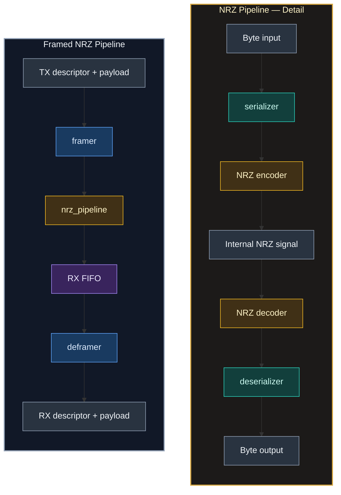

# Framed NRZ Serial Datapath — FPGA RTL and Verification

A SystemVerilog transmit/receive datapath combining **byte framing, MSB-first serialization, NRZ level encoding, deserialization, and FIFO-buffered frame recovery**. The project includes self-checking component and end-to-end testbenches, plus a Nexys A7-100T top level for a switch-to-LED loopback demonstration.

The current implementation is a **single-clock, internal loopback prototype**. The encoded line connects transmitter and receiver inside the design, with receive sampling derived from local transmit activity rather than an independent receiver clock.

## Architecture

`framed_nrz_pipeline` is the integration module. It connects a transmit framer, the existing byte-to-bit-to-byte `nrz_pipeline`, a receive FIFO, and a deframer:



The framed_nrz_pipeline module integrates the transmit framer, nrz_pipeline transport block, receive FIFO, and deframer. The transport block serializes bytes MSB-first, applies NRZ encoding, samples the internal encoded signal, and reconstructs bytes. The receive FIFO buffers the reconstructed stream before deframing.

The nested `nrz_pipeline` also contains the transmit bit-tick generator and locally derives its receive-sampling tick. The encoded line is an **internal RTL signal**, not an external FPGA pin or Ethernet PHY connection.

`framed_nrz_pipeline` integrates the following blocks:

| Block | Responsibility |
| --- | --- |
| **Framer** | Accept a frame descriptor and payload stream; emit the preamble, header, and exactly the declared number of payload bytes. |
| **Serializer / NRZ encoder** | Send each byte MSB-first and drive the bit value onto an NRZ-level signal on a generated transmit bit tick. |
| **NRZ decoder / deserializer** | Sample the encoded signal on a delayed local receive tick and reconstruct bytes MSB-first. |
| **RX FIFO** | Buffer reconstructed bytes before the deframer; supports ready/valid backpressure and empty-state fall-through. |
| **Deframer** | Search for the preamble, recover frame metadata, and deliver the declared payload length through a ready/valid interface. |

A configurable bit-tick generator divides the system clock to the requested bit rate. At the Nexys A7 configuration of **100 MHz** and **1 Mb/s**, each transmitted bit occupies 100 system-clock cycles. The divider assumes `CLK_HZ` is an integer multiple of `BIT_RATE`.

The receiver's sample tick is delayed from an accepted transmit-bit transfer; there is **no clock-data recovery or independent receive clock**. Consequently, the loopback exercises byte/bit conversion and frame handling, not synchronization to an external serial source.

### Frame format

The framing protocol uses a four-byte header followed by a length-delimited payload:

```text
+----------+----------+----------+----------+---------------------+
| Preamble |   Type   | Sequence |  Length  |       Payload       |
|   0x55   |  1 byte  |  1 byte  |  1 byte  |    0–255 bytes      |
+----------+----------+----------+----------+---------------------+
```

- **Preamble:** One byte (`0x55`) used by the deframer to locate the start of a frame.
- **Type:** An eight-bit field carried through the frame descriptor. The current framing logic does not assign protocol behavior to particular type values.
- **Sequence:** An eight-bit field preserved by the receiver; there is no sequence-window management or retransmission logic.
- **Length:** Number of payload bytes following the header. Zero-length frames are supported; the maximum is 255 bytes.

Because payload length is explicit, `0x55` can appear within a payload without being treated as a new frame boundary.

### Flow control and buffering

Byte-side transfers use `valid && ready` handshakes. The framer accepts a descriptor separately from payload data, keeps header bytes stable during stalls, and propagates payload backpressure to its source. The deframer presents the recovered descriptor for acceptance before releasing the payload.

The RX FIFO buffers reconstructed bytes during temporary deframer stalls, including descriptor handshakes. It supports ready/valid backpressure and an empty-state fall-through path. The serial decoder itself cannot be stalled; sustained receiver congestion beyond available buffering is therefore outside the supported link behavior.

## Verification

The repository contains self-checking SystemVerilog testbenches using assertions, expected-data queues, directed scenarios, and randomized traffic. They exercise both individual blocks and the full framed path.

| Testbench | Main coverage |
| --- | --- |
| [`nrz_pipeline_tb.sv`](tb/nrz_pipeline_tb.sv) | Byte-level round trips through serialization, NRZ encoding/decoding, and deserialization. |
| [`framer_tb.sv`](tb/framer_tb.sv) | Header ordering, metadata capture, zero- and 255-byte payloads, source/output stalls, reset, back-to-back frame starts, and randomized traffic. |
| [`deframer_tb.sv`](tb/deframer_tb.sv) | Preamble search, metadata and payload scoreboards, descriptor/payload backpressure, input gaps, reset during partial frames, and randomized traffic. |
| [`sync_fifo_tb.sv`](tb/sync_fifo_tb.sv) | Empty fall-through, full/empty boundaries, simultaneous transfers, pointer wraparound, reset while occupied, and randomized traffic. |
| [`framed_nrz_pipeline_tb.sv`](tb/framed_nrz_pipeline_tb.sv) | End-to-end frame recovery, zero-length and maximum-length frames, metadata preservation, payload `0x55`, sequential frames, source stalls, and randomized RX backpressure. |

The integrated testbench checks received frame descriptors and payload bytes against expected queues; the independent framer, deframer, and FIFO tests exercise additional protocol edge cases. This is functional RTL verification under the shared-clock loopback model, not verification of an external electrical link.

### Running the testbenches

Run the simulation helper from the repository root with **Verilator**, a C++ compiler, and `make` installed. The helper compiles testbenches with SystemVerilog assertions enabled and stops on a failure.

```bash
# Complete five-testbench suite
./scripts/run_sim.sh all

# Individual testbench, or default NRZ smoke test
./scripts/run_sim.sh framed_nrz_pipeline
./scripts/run_sim.sh
```

Available selections are `nrz_pipeline`, `framer`, `deframer`, `sync_fifo`, `framed_nrz_pipeline`, and `all`. Each testbench uses its own Verilator build directory under `obj_dir/`, which is excluded by `.gitignore`.

## Nexys A7 integration

[`rtl/nexys_a7_top.sv`](rtl/nexys_a7_top.sv) instantiates the framed datapath with **8-bit data, 1 Mb/s NRZ, and a 32-byte RX FIFO**. It sends a single payload byte per button-initiated frame through the internal loopback.

| Board control | Function |
| --- | --- |
| `CLK100MHZ` | 100 MHz system clock. |
| `BTNC` | Active-high reset. |
| `SW[7:0]` | Payload byte, captured when a send-button press is detected. |
| `BTNU` | Initiates a frame carrying the captured byte (`type = 0x01`, `length = 1`). |
| `LED[7:0]` | Most recently received payload byte. |
| `LED[8]`, `LED[9]` | Latched indicators for accepted TX descriptor and TX payload. |
| `LED[10]`, `LED[11]` | Latched indicators for accepted RX descriptor and RX payload. |

The top-level logic synchronizes the send button and detects a rising edge. It increments an eight-bit sequence counter after the TX payload is accepted; the value travels in the frame header. The status LEDs remain asserted after their respective events until reset.

The project includes a **Vivado 2024.2** project at [`vivado/nrz_pipeline/nrz_pipeline.xpr`](vivado/nrz_pipeline/nrz_pipeline.xpr), targeting the Nexys A7-100T (`xc7a100tcsg324-1`). The accompanying [`Nexys A7 XDC`](constraints/Nexys-A7-100T-Master.xdc) maps the clock, eight switches, buttons, and LEDs used by the top level. Open the project in Vivado, confirm `nexys_a7_top` is selected as the synthesis top, and run synthesis, implementation, and bitstream generation before programming the board.

**This demonstration is entirely on-chip:** it does not drive an external serial pin or interface with the Nexys A7 Ethernet PHY.

## Repository layout

| Path | Contents |
| --- | --- |
| [`rtl/framed_nrz_pipeline.sv`](rtl/framed_nrz_pipeline.sv) | Integrated framing, NRZ byte/bit transport, RX FIFO, and deframing. |
| [`rtl/framer.sv`](rtl/framer.sv), [`rtl/deframer.sv`](rtl/deframer.sv) | Custom byte-framing transmit and receive state machines. |
| [`rtl/nrz_pipeline.sv`](rtl/nrz_pipeline.sv) | Unframed serialization, NRZ loopback, and deserialization. |
| [`rtl/`](rtl/) | Bit-tick generator, codec, serializer, deserializer, FIFO, and FPGA top level. |
| [`tb/`](tb/) | Component and integrated self-checking testbenches. |
| [`scripts/`](scripts/) | Verilator runner for individual testbenches or the full suite. |
| [`vivado/`](vivado/), [`constraints/`](constraints/) | Nexys A7 Vivado project and pin/clock constraints. |

## Limitations

- **Receive timing:** RX sampling is derived from local TX transfers. There is no clock-data recovery, external receive interface, or asynchronous clock-domain crossing.
- **Protocol scope:** Only NRZ level coding is implemented (not NRZI or Manchester). The custom frame format has no CRC/FCS, error reporting, acknowledgments, retransmissions, or sliding-window control. The type and sequence fields are carried as metadata, not interpreted as a reliability protocol.
- **Flow control:** The line decoder has no downstream bit-level backpressure; finite RX buffering does not guarantee lossless operation under arbitrary stalls.
- **Physical integration:** The current board-level path is an internal loopback, not an Ethernet MAC/PHY implementation, and has not been characterized as an external hardware link.
- **Parameterization:** Framing and deframing operate on eight-bit bytes; the integrated framed path is intended for `DATA_WIDTH=8`.
- **Timing and verification:** The integer clock-divider ratio is assumed; the testbenches do not establish timing closure, bit-error performance, or independent-link robustness. The send-button input is synchronized but not debounced.
